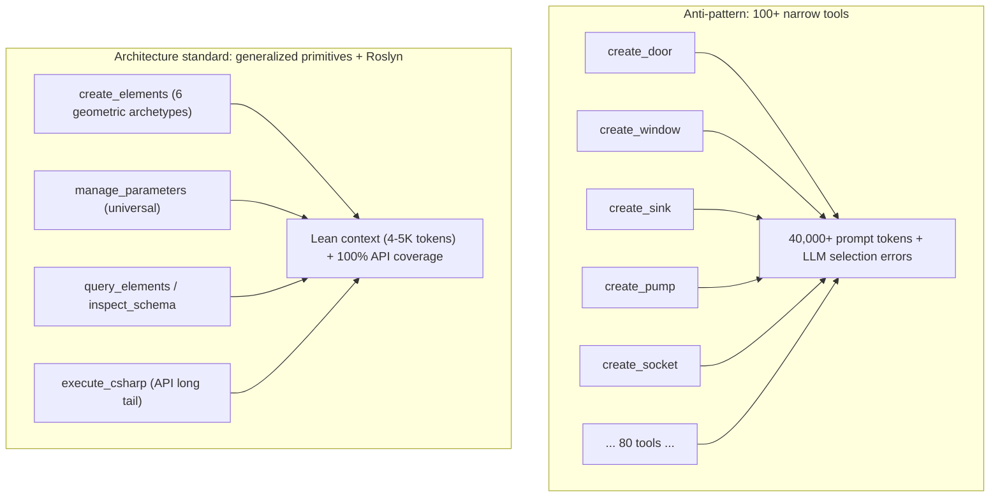

# Architecture analysis: the boundary between MCP tools and C# code (Revit API)

> **The key architecture question:**  
> *"Should every Revit button and category be moved into the MCP server, or should most of them stay with C# code written by the agent?"*

---

## 1. The fundamental principle: why 100+ MCP tools is a dead end

The Revit UI shows a human user **more than 80 buttons** across the Structure, Architecture, Systems and Annotate tabs. Turning every button into a separate MCP tool (`create_door`, `create_window`, `create_toilet`, `create_pump`, `create_light`, `create_diffuser`...) creates three critical problems:

1. **Context bloat (an LLM context-window disaster):**
   - The MCP client (Claude, Cursor, Antigravity) reloads the full JSON schema of every tool into the system prompt at every step of the dialogue.
   - 80 tools with complex parameters will eat **40,000 to 70,000 tokens of context** before the user has typed the first word.
2. **Tool selection paralysis (choice hallucinations):**
   - Models start confusing similar tools (e.g. place a pump with `create_pump`, `create_mechanical_equipment` or `create_component`?).
3. **Maintenance fragility:**
   - 100 separate DTOs and handlers must be maintained across 9 Revit versions (2019–2027) while Autodesk keeps changing API signatures.



---

## 2. The Revit API secret: visual buttons vs internal geometric archetypes

Although the Revit UI has dozens of different buttons, **the Revit API reduces all that variety to just 5–6 geometric archetypes**:

| Geometric archetype in the API | Revit ribbon buttons (human UI) | Revit API method | How it is exposed in MCP |
|---|---|---|---|
| **1. Point-based instance** | Door, Window, Furniture, Plumbing fixture, Light fixture, Electrical device, HVAC equipment, Sprinkler, Isolated foundation | `doc.Create.NewFamilyInstance(XYZ, Symbol, Level/Host)` | **One tool:** `family_instance` inside `create_elements` |
| **2. Curve-based segment** | Wall, Beam, Bracing, Reference plane, Model line, Detail line | `doc.Create.NewFamilyInstance(Curve, ...)` or `Wall.Create(Curve)` | `wall`, `beam`, `model_curve` |
| **3. Planar profile loop** | Floor, Foundation slab, Ceiling, Roof, Filled region, Reinforcement area | `Floor.Create(CurveLoop[])`, `Ceiling.Create`, `FilledRegion.Create` | `slab`, `area_reinforcement` |
| **4. MEP linear run** | Duct, Pipe, Cable tray, Conduit | `Duct.Create(...)`, `Pipe.Create(...)`, `CableTray.Create(...)` | Planned generalized `mep_curve` |
| **5. Rebar curve wire** | Rebar bar, Stirrup, Tie, U-bar | `Rebar.CreateFromCurves(...)` | `rebar` inside `create_elements` |

> [!IMPORTANT]
> **Conclusion:** we do not need 50 tools for plumbing, electrical and doors. The `family_instance` tool **already creates 80% of the elements found on all five ribbon tabs** (any point-based family of any category).

---

## 3. A detailed walk through the five ribbon screenshots: MCP vs C# code

### Screenshot 1: the "Structure" tab

| Group / button | In MCP or in code? | Rationale |
|---|---|---|
| **Beam, Column, Floor, Wall** | **MCP tool** (`create_elements`) | Fundamental load-bearing primitives, called thousands of times, strict contract (points in mm). |
| **Truss** | **Code (`execute_csharp`)** | Complex chords, diagonals and posts (`Truss.Create`). Rarely needed, would be bulky in MCP. |
| **Bracing** | **MCP tool** (`beam`) | In the Revit API a brace is created with the same `NewFamilyInstance(Curve)` and `StructuralType.Bracing`. |
| **Beam System** | **Code (`execute_csharp`)** | A composite parametric object with spacing rules and layout direction. |
| **Foundations: isolated** | **MCP tool** (`family_instance`) | An ordinary point-based family of category `OST_StructuralFoundation`. |
| **Foundations: slab** | **MCP tool** (`slab`) | A floor slab with a foundation slab type. |
| **Rebar bar, Reinforcement area** | **MCP tool** (`create_elements`) | Basic reinforcement primitives, used constantly. |
| **Rebar mesh, Cover, Couplers** | **Code (`execute_csharp`)** | Specific operations solved faster and cleaner with a short script. |
| **Openings (shaft, by face, in wall)** | **MCP tool** (`create_elements: opening`) | The basic geometry-cutting primitive. |

---

### Screenshot 2: the "Architecture" tab

| Group / button | In MCP or in code? | Rationale |
|---|---|---|
| **Wall, Door, Window, Component** | **MCP tool** (`create_elements`) | Basic architectural elements. Doors and windows are `family_instance` with a host wall (`hostElementId`). |
| **Roof, Ceiling** | **MCP tool** (`slab` / `ceiling`) | Horizontal planar loops with thickness. |
| **Curtain walls (wall, mullions)** | **Code (`execute_csharp`)** | Multi-element systems with complex grid division (`CurtainGrid`). |
| **Stairs, Ramp, Railing** | **Code (`execute_csharp`)** | **Definitely code!** Creating stairs in the API requires the mutable sketch context `StairsEditScope`. Encoding it into a JSON schema is a path to broken code. The agent generates readable C# with a `StairsEditScope` transaction. |
| **Rooms** | **MCP tool** (`create_elements: room`) | Already implemented in MCP (UV insertion point and level binding). |
| **Room separator** | **MCP tool** (`model_curve`) | Room boundary lines. |

---

### Screenshots 3 and 4: the "Systems" tab (MEP: HVAC, plumbing, electrical)

| Group / button | In MCP or in code? | Rationale |
|---|---|---|
| **Duct, Pipe, Cable tray, Conduit** | **MCP tool** (`create_elements: mep_curve`) | A single linear primitive for all four MEP disciplines (start, end, diameter/size, system). |
| **Any equipment (HVAC, plumbing, electrical, luminaires, sockets, sprinklers)** | **MCP tool** (`create_elements: family_instance`) | All 20+ ribbon buttons are **the same point-based family**! `family_instance` already covers them entirely. |
| **Fittings, elbows, tees, transitions** | **Code (`execute_csharp`)** | Connecting connectors (`Connector.ConnectTo`) requires spatial matching of geometric normals and flow vectors. That is an algorithmic task for the agent. |
| **System routing, hydraulics, sizing** | **Code (`execute_csharp`)** | Business logic and calculation algorithms owned by the agent. |

---

### Screenshot 5: the "Annotate" tab (drawing production)

| Group / button | In MCP or in code? | Rationale |
|---|---|---|
| **Dimensions (aligned, linear)** | **MCP tool** (`create_dimensions`) | High frequency: dimension chains along grids or walls. Should be a simple, fast tool. |
| **Spot elevation** | **MCP tool** (`create_dimensions`) | Level marks on plans and sections. |
| **Tag by category / Tag all** | **MCP tool** (`tag_elements`) | A critical automation tool: tag walls, floors, columns or rebar. |
| **Detail line, Text** | **MCP tool** (`create_annotation`) | 2D detailing of nodes. |
| **Revision cloud, Insulation, Complex nodes** | **Code (`execute_csharp`)** | Rare, highly specialized operations. |

---

## 4. The golden rule of the split (decision matrix)

```
                        USAGE FREQUENCY
                     Rare                 Frequent
              ┌─────────────────────┬─────────────────────┐
     Complex  │      CODE ZONE      │     AGENT ZONE      │
     geo-     │   (execute_csharp)  │ (Code + SP maths)   │
     metry /  │                     │                     │
     sketches │  • Stairs, ramps    │  • Rebar design     │
COMPLEXITY    │  • Curtain walls,   │  • MEP routing      │
              │    trusses          │                     │
              ├─────────────────────┼─────────────────────┤
     Standard │      CODE ZONE      │       MCP ZONE      │
     contract │   (execute_csharp)  │   (direct tools)    │
     (point,  │  • Beam systems     │  • Walls, beams,    │
     line)    │  • Steel connections│    floors, columns  │
              │  • View filters     │  • Tags, dimensions │
              │                     │  • family_instance  │
              └─────────────────────┴─────────────────────┘
```

### Three simple questions before adding a new MCP tool:

1. **Does the operation have a simple, stable input contract in millimetres?**
   - *Yes (point, segment, closed loop)* → **MCP candidate**.
   - *No (needs an interactive sketch, an `EditScope` context, 15 approval steps)* → **C# code**.
2. **Is the operation called at scale (hundreds of times per project)?**
   - *Yes (tag elements, read parameters, place beams or walls)* → **MCP** (saves tokens and time).
   - *No (one spiral staircase per project)* → **C# code**.
3. **Does the operation require algorithmic calculations against standards (SP 63, SP 60)?**
   - *Yes (rebar lap length, duct diameter)* → **the agent's brain computes it and calls a primitive**.
   - *No (just create an object at known coordinates)* → **MCP primitive**.

---

## 5. Recommended MCP tool roadmap

To cover 98% of the needs of all five ribbon tabs without inflating the context, a compact set is enough:

| MCP tool | Purpose | Ribbon tabs covered |
|---|---|---|
| **`create_elements`** *(exists)* | Basic primitives: `wall`, `slab`, `beam`, `column`, `family_instance`, `rebar`, `area_reinforcement`, `room`, `level`, `grid`, `model_curve`. | Structure, Architecture, MEP equipment |
| **`manage_parameters`** *(exists)* | Batch read and write of any parameter in SI units with automatic conversion. | All areas |
| **`query_elements` / `inspect_schema`** *(exists)* | Element search, filtering, inspection of category and type structure. | All areas |
| **`export_view_image`** *(exists)* | Vision control of geometry and drawings through multimodal LLMs. | All areas |
| **`tag_elements`** *(recommended)* | Element tagging (by category or bulk) with leaders in mm. | Annotate |
| **`create_dimensions`** *(recommended)* | Dimensions (chains along grids, walls, overall sizes) in mm. | Annotate |
| **`create_mep_curve`** *(recommended)* | Linear MEP runs (`duct`, `pipe`, `cable_tray`, `conduit`). | Systems |
| **`export_schedule`** *(recommended)* | Tabular schedule data without scanning the model. | Schedules |
| **`execute_csharp`** *(exists)* | **The universal lifeline** for the remaining 100% of non-standard Revit API tasks (stairs, curtain walls, connections, custom scripts). | Any Revit API operation |
