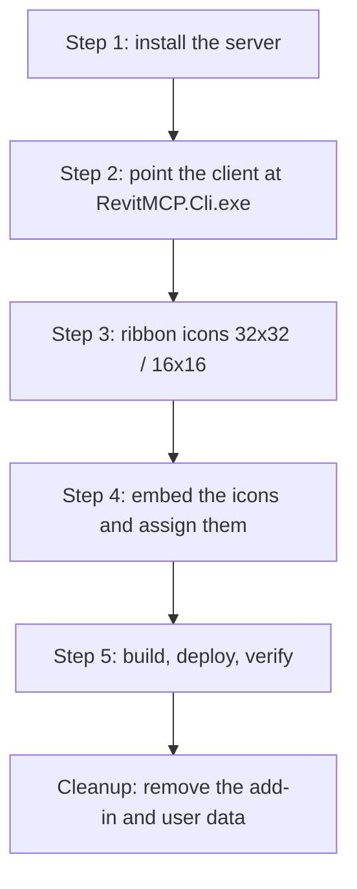

# Deployment and cleanup

This guide covers deploying the add-in, pointing a client at the native C# server and removing everything cleanly when you no longer need it.

## 1. Goals

1. **Install the server**
   - Binaries live in `%LocalAppData%\RevitMCP\`; the Revit folder receives one `.addin` manifest per supported version.
2. **Reconfigure the agent client**
   - Point it at the native `RevitMCP.Cli.exe` (.NET 8) server.
   - Verify that the full tool set (22 tools) is exposed.
3. **Ribbon icon**
   - `assets/icon32.png` (32×32) for `LargeImage`, `assets/icon16.png` (16×16) for `Image`, embedded as `Resource` in `src/RevitMCP.Plugin/RevitMCP.Plugin.csproj` and assigned in [RevitMcpApp.cs](../../src/RevitMCP.Plugin/RevitMcpApp.cs).
4. **Build, deploy, verify**
   - Build and deploy for a specific Revit version, then check the ribbon and the MCP handshake.

---

## 2. Step-by-step



### Step 1. Install

1. **Installer** — run `RevitMCP-Setup-<version>.exe`. It copies the CLI, the plugin assemblies for every Revit version and generates `RevitMCP.addin` manifests under `%APPDATA%\Autodesk\Revit\Addins\<year>\`.
2. **Manual deployment** — for a single version use `deploy-addin.ps1` (see Step 5); it writes the same manifest and copies the assemblies to `%LocalAppData%\RevitMCP\bin\<year>\`.

| Object | Path |
|---|---|
| Assemblies per Revit version | `%LocalAppData%\RevitMCP\bin\<year>\` |
| CLI | `%LocalAppData%\RevitMCP\bin\cli\RevitMCP.Cli.exe` |
| Manifest | `%APPDATA%\Autodesk\Revit\Addins\<year>\RevitMCP.addin` |
| BIM-Map databases | `%LocalAppData%\RevitMCP\models\` |
| Agent knowledge base | `%LocalAppData%\RevitMCP\knowledge\` |
| Logs | `%LocalAppData%\RevitMCP\logs\` |

> [!NOTE]
> If a `.dll` is locked by a running Revit process, delete the `.addin` manifest first (Revit then stops loading the add-in) and remove the folder as soon as the lock is released.

---

### Step 2. Point the client at the native server

1. **Configuration file** — depends on the client, see [README](../../README.md#connecting-an-ai-client).
2. **Entry** — use a direct call to the compiled CLI:

   ```json
   {
     "mcpServers": {
       "revit": {
         "command": "%LOCALAPPDATA%\\RevitMCP\\bin\\cli\\RevitMCP.Cli.exe",
         "args": []
       }
     }
   }
   ```

3. **Validate**
   - Run the stdio JSON-RPC handshake (`initialize` → `tools/list`).
   - Confirm that all 22 tools are returned (`query_elements`, `execute_csharp`, `get_bim_map`, `manage_parameters` and the rest).

---

### Step 3. Ribbon icons (32×32 and 16×16)

1. **Visual language**
   - Architectural form: an isometric BIM volume (axonometric cube / building frame).
   - Technology accent: teal gradient (`#00A88F` → `#4EC9B0`).
   - AI node: a glowing connection or spark (`#569CD6` / `#4FC1FF`) at the top node of the frame.
   - Transparent background (32-bit PNG with alpha), legible on both light and dark Revit themes.
2. **Formats**
   - `assets/icon32.png` (32×32 px, 96 DPI — the `RibbonButton.LargeImage` standard).
   - `assets/icon16.png` (16×16 px, 96 DPI — the `RibbonButton.Image` standard).
3. **Tooling** — any vector editor or Python + Pillow (anti-aliased, pixel-aligned, no blur).

---

### Step 4. Embed the icons and assign them to the ribbon

1. **Project** — [RevitMCP.Plugin.csproj](../../src/RevitMCP.Plugin/RevitMCP.Plugin.csproj): keep the images in `src/RevitMCP.Plugin/Resources/` and declare them as `Resource` so they are packed into the assembly.
2. **Ribbon initialization** — [RevitMcpApp.cs](../../src/RevitMCP.Plugin/RevitMcpApp.cs):

   ```csharp
   showPaneButton.LargeImage = LoadRibbonImage("icon32.png");
   showPaneButton.Image = LoadRibbonImage("icon16.png");
   ```

   Load `BitmapImage` through `GetManifestResourceStream` or the `pack://application:,,,/` URI, and keep the loader fault-tolerant: a missing icon must not break `OnStartup`.

---

### Step 5. Build, deploy, verify

```powershell
# build the plugin for the target Revit version
dotnet build src\RevitMCP.Plugin\RevitMCP.Plugin.csproj -c R2023

# tests
dotnet test tests\RevitMCP.Tests\RevitMCP.Tests.csproj -c R2025

# deploy
.\deploy-addin.ps1 -RevitYear 2023
```

Check that the **Revit MCP** tab shows the button with the 32×32 icon, the button opens the agent pane, and the client receives a reply from the server.

---

## 3. Cleanup and uninstall

1. **Uninstaller** — run *Apps & features → Revit MCP → Uninstall*. It removes the binaries and the `.addin` manifests and asks whether to keep the agent memory.
2. **Manual cleanup**

   | Object | Path | Action |
   |---|---|---|
   | Manifest | `%APPDATA%\Autodesk\Revit\Addins\<year>\RevitMCP.addin` | Delete the file |
   | Assemblies | `%LocalAppData%\RevitMCP\bin\` | Delete the folder |
   | BIM-Map, knowledge, logs | `%LocalAppData%\RevitMCP\` | Delete the folder if the agent memory is not needed |
   | Client entry | the client configuration file | Remove the `revit` server block |

3. **Verify** — restart Revit: the **Revit MCP** tab must be gone, and the client must report a missing server instead of a stale session.
