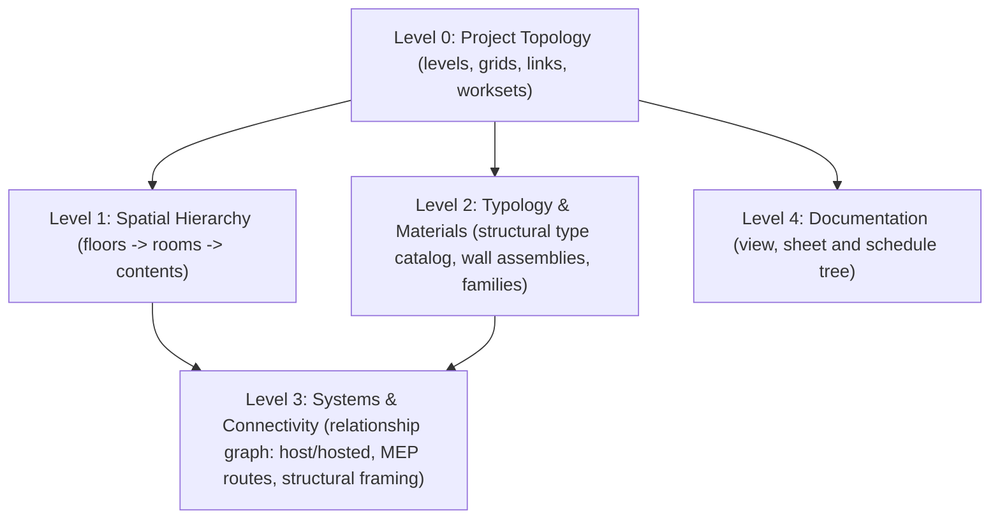

# Technical Specification (ToR): Revit MCP Server (C# Edition)

> **Version:** 1.0.0-DRAFT
> **Status:** In review / Active development
> **Stack:** C# 12, .NET 8 (Revit 2025–2026), .NET Framework 4.8 (Revit 2020–2024), Roslyn Scripting, Windows Named Pipes, Model Context Protocol (MCP).

---

## 1. Introduction and project goals

### 1.1. Problems of common approaches
Typical Revit MCP implementations:
- Split the logic between a scripting runtime and an add-in, so every workstation needs an extra runtime and fragile native modules.
- Communicate over a raw TCP socket with a hard 8 KB buffer limit and no framing, which causes data truncation.
- Pop up blocking `TaskDialog.Show` modal dialogs on errors, freezing the Revit process and causing LLM timeouts.
- **Critical code-execution flaw:** wrap all arbitrary code in a forced `Transaction` on the open document. This makes it impossible to open, save, or close documents, batch-process files, or work with `UIApplication`.
- Lack full support for Revit's complexity (families, types, parameters, categories, units of measurement).

### 1.2. Goals of the new version
1. **A single C# (.NET) stack:** no external runtime dependencies, one language for the CLI, the add-in and the tests.
2. **Reliable high-speed transport:** communication over Windows Named Pipes with streaming support for data of any size (JSON-RPC 2.0 / NDJSON).
3. **Unconstrained code-execution context (Unconstrained Scripting):** the AI gains access to `UIApplication`, `UIDocument`, and `Document`, and manages transactions itself or works entirely without them (batch processing, export, opening/saving files).
4. **Deep support for Revit's BIM structure:** model schema exploration (introspection of categories, families, types, parameters), a universal query engine, and a parameter manager with automatic unit conversion (SI <-> Revit internal feet).
5. **Zero-Modal Policy:** an absolute ban on modal dialogs in automated mode. All errors are translated into structured JSON-RPC.

---

## 2. System architecture

Overall component interaction diagram:

```
┌─────────────────────────────────────────────────────────────┐
│          MCP Client (Claude, Cursor, Antigravity)           │
└──────────────────────────────┬──────────────────────────────┘
                               │  Standard MCP (stdio: JSON-RPC)
                               ▼
┌─────────────────────────────────────────────────────────────┐
│                  RevitMCP.Cli (C# .NET 8)                   │
│  - Lightweight single-file console process                  │
│  - MCP tools, resources and prompts handler                 │
│  - Named Pipe client                                        │
└──────────────────────────────┬──────────────────────────────┘
                               │  Windows Named Pipe: \\.\pipe\RevitMCP-{RevitYear}-{ProcessId}
                               │  Bidirectional NDJSON stream, unlimited size
                               ▼
┌─────────────────────────────────────────────────────────────┐
│       RevitMCP.Plugin (Revit add-in inside revit.exe)       │
│  ┌───────────────────────────────────────────────────────┐  │
│  │ NamedPipeServer (background IPC listener)             │  │
│  └───────────────────────────┬───────────────────────────┘  │
│                              ▼                              │
│  ┌───────────────────────────────────────────────────────┐  │
│  │ RevitTaskDispatcher (ExternalEvent / UI Thread Sync)  │  │
│  └───────────────────────────┬───────────────────────────┘  │
│                              ▼                              │
│  ┌───────────────────────────────────────────────────────┐  │
│  │ Core Services:                                        │  │
│  │ • Unconstrained Script Engine (Roslyn + ALC)          │  │
│  │ • Schema Inspector (Categories, Families, Types)      │  │
│  │ • Universal Element Query (Facade over Collector)     │  │
│  │ • Universal Parameter Manager (BuiltIn, Shared, SI)   │  │
│  │ • Document Lifecycle Manager (Open, Save, Close, Sync)│  │
│  │ • Unit Converter Pipeline (Feet <-> Metric)           │  │
│  └───────────────────────────────────────────────────────┘  │
│                              │                              │
│                              ▼                              │
│                    Autodesk Revit Engine                    │
└─────────────────────────────────────────────────────────────┘
```

### 2.1. Solution project composition (`RevitMCP.sln`)

| Project | Target platform | Description |
| :--- | :--- | :--- |
| **`RevitMCP.Cli`** | .NET 8 (AOT / Single File) | Standalone MCP server for connecting to AI clients over `stdio`. Translates tool calls into the Revit plugin's Named Pipe. |
| **`RevitMCP.Plugin`** | .NET 8 (Revit 2025–2026) / .NET Framework 4.8 (Revit 2020–2024) | Revit add-in that listens on a Named Pipe, dispatches tasks to the Revit API thread, and implements the model services. |
| **`RevitMCP.Shared`** | .NET Standard 2.0 / .NET 8 | Shared DTOs, JSON-RPC serialization protocols, request/response contracts, error codes. |

### 2.2. Build configuration and multi-targeting (`Directory.Build.props`)
Following the architecture of the reference `Reinforcement` project:
- Project configurations: `R2020` .. `R2026`.
- `TargetFramework`:
  - `net48` for Revit 2020–2024.
  - `net8.0-windows` for Revit 2025–2026.
- Referencing the official Revit API assemblies via the `Revit_All_Main_Versions_API_x64` NuGet package (versioning `$(RevitVersion).*`), removing the build process's dependency on locally installed Revit instances.

---

## 3. Unconstrained code-execution engine (Unconstrained Scripting)

### 3.1. Execution context (`IRevitScriptContext`)
The AI script runs inside a safe, isolated context with full access to the Revit API.

```csharp
namespace RevitMCP.Shared.Scripting
{
    public interface IRevitScriptContext
    {
        // Access to the application-level API
        UIApplication App { get; }
        Autodesk.Revit.ApplicationServices.Application Application { get; }

        // Access to the active document (null when no project is open)
        UIDocument UIDoc { get; }
        Document Doc { get; }

        // Helper methods for transaction management (on demand)
        T WithTransaction<T>(string transactionName, Func<T> action);
        void WithTransaction(string transactionName, Action action);
        
        T WithTransactionGroup<T>(string groupName, Func<T> action);
        void WithTransactionGroup(string groupName, Action action);

        // Streaming log output for the LLM
        void Print(object message);
    }
}
```

### 3.2. User code compilation template
AI code is compiled via Roslyn into a method with the following structure:

```csharp
using System;
using System.IO;
using System.Linq;
using System.Collections.Generic;
using Autodesk.Revit.DB;
using Autodesk.Revit.UI;
using RevitMCP.Shared.Scripting;

namespace RevitMCP.DynamicExecution
{
    public class UserScript
    {
        public static object Run(IRevitScriptContext ctx, Dictionary<string, object> args)
        {
            // This is where the AI-generated code runs.
            // The AI has full freedom:
            // 1. Work without transactions (reading, batch file processing).
            // 2. Open documents: ctx.App.Application.OpenDocumentFile("...").
            // 3. Save and close: doc.Save(); doc.Close(false);
            // 4. Open transactions only selectively:
            //    ctx.WithTransaction("Create Walls", () => { ... });
            
            return null; // The return value is serialized to JSON and handed back to the AI
        }
    }
}
```

### 3.3. Isolation and memory-leak prevention
- **Revit 2025–2026 (.NET 8):** uses `AssemblyLoadContext(name, isCollectible: true)`. After each execution the dynamic assembly is immediately unloaded from memory (`WeakReference` + `Unload()`).
- **Revit 2020–2024 (.NET Framework 4.8):** source-code hashing (SHA-256) and caching of compiled delegates in a `ConcurrentDictionary<string, Func<...>>`. Re-running a script does not create new assemblies in the AppDomain.
- **Error diagnostics:** on compilation or runtime errors, the call stack is mapped to the original user-code lines, allowing the LLM to fix the error instantly on the next call.

### 3.4. 64-bit `ElementId` typing (Revit 2024+ compatibility)
- Starting with Revit 2024, Autodesk moved `ElementId` from a 32-bit `int` to `Int64` (`long`), declaring `IntegerValue` obsolete.
- In all `RevitMCP.Shared` DTOs and interfaces, element IDs are strictly typed as `long`.
- Plugin adapter:
  - Revit 2020–2023: `(long)element.Id.IntegerValue`
  - Revit 2024–2026: `element.Id.Value`
- This eliminates bit-width overflow and failures on very large BIM models.

### 3.5. Transaction grouping and single undo (Undo / `Ctrl+Z`)
- If an agent performs a chain of dozens of actions (e.g. laying out 50 columns or renumbering rooms), creating a separate transaction for each step clutters the Undo stack and makes rollback impossible for the engineer.
- Transaction group management (`TransactionGroup`) is supported: a batch of AI actions is combined into a single named undo entry (e.g. *"AI (Claude): Beam layout on the grid"*). The user can undo the entire agent's work **with a single Ctrl+Z**.

---

## 4. Core MCP tools specification

Instead of hundreds of scattered commands, the platform provides a universal set of powerful tools:

### 4.1. `inspect_schema` — Structure and type exploration
Lets the AI eliminate hallucinations and obtain up-to-date data about the project structure.
- **Input parameters:**
  - `target`: `categories` | `families` | `family_symbols` | `parameters`
  - `categoryName`: optional category filter (e.g. `OST_Walls`, `OST_Doors`)
  - `familyId` / `familyName`: optional family filter
  - `elementId`: retrieval of all parameters (instance and type) of a specific element
- **Output data:** a list of available entities with their IDs, names, categories, and metadata (storage type, units of measurement, ReadOnly flag).

### 4.2. `query_elements` — Universal model element collection
Replaces all ad-hoc read tools. Built on top of an optimized `FilteredElementCollector`.
- **Input parameters:**
  - `category`: a `BuiltInCategory` name (e.g. `OST_Windows`)
  - `viewId`: view filter (the active view, or `null` for the whole model)
  - `levelId`: level filter
  - `parameterFilter`: an array of filter rules (e.g. `[{ param: "Mark", op: "Contains", value: "A-1" }]`)
  - `boundingBox`: a spatial 3D filter (min/max in millimeters)
  - `limit`: limit on returned elements (default 100)
  - `offset`: pagination offset
- **Output data:** an array of objects with basic properties (`Id`, `UniqueId`, `Name`, `Category`, `FamilyName`, `TypeName`, coordinates in mm, key parameters).

### 4.3. `manage_parameters` — Universal parameter manager
Batch reading and writing of any element parameters.
- **Input parameters:**
  - `action`: `get` | `set`
  - `elementIds`: array of element IDs
  - `parameters`: array of parameter objects:
    - `name` / `builtInName` / `guid`: parameter identifier
    - `value`: value to write (number, string, element ID)
    - `unit`: optional unit specification (e.g. `"mm"`, `"m2"`, `"degrees"`)
- **Features:** automatic conversion of user metric units into Revit's internal units via `UnitUtils`.

### 4.4. `manage_documents` — Document lifecycle
Management of projects and files.
- **Actions (`action`):**
  - `list`: list of all open documents with flags (active, in memory, modified).
  - `open`: open a `.rvt` / `.rfa` file by path (in the background or in the UI).
  - `save`: save the active document.
  - `save_as`: save to a new path.
  - `close`: close a document (with or without saving).
  - `sync_with_central`: synchronize the central file, passing a sync comment.
  - `export`: export a view/model to PDF, IFC, DWG, PNG (Base64 for vision models).

### 4.5. `manage_instances` — Routing between multiple Revit windows
Ensures correct behavior when the user has several Revit instances running in parallel (different versions or different projects).
- **`list_revit_instances`**: returns a list of all running sessions (PID, Revit version 2020-2026, window title, active file path, readiness status `Ready` / `InSketchMode` / `ModalActive`).
- **`select_revit_instance`**: switches the MCP server's focus to a specific Revit process (by PID or file name).
- **Smart Routing (default):**
  - If **1 Revit instance** is running — connection happens automatically and seamlessly.
  - If **several instances** are running — the CLI automatically routes requests to the active window with user focus, or the AI selects the right instance by the name of the open document.

### 4.6. `transform_elements` — Spatial transformations
- **Actions (`action`):** `move` | `rotate` | `copy` | `delete`
- **Parameters:** `elementIds` (of type `long`), offset vector `dx, dy, dz` (in mm), rotation axis and angle (in degrees).

### 4.7. `execute_csharp` — Execution of arbitrary C# code
Maximum freedom of action for complex scenarios and automations not covered by the standard tools.
- **Parameters:** `code` (a C# code string), `arguments` (a dictionary of arbitrary arguments).
- **Result:** the serialized result of the `Run()` function, console logs, execution time, or a detailed compilation/runtime error.
- **Security and audit:** all executed scripts are recorded with a timestamp and agent name in `%LocalAppData%/RevitMCP/logs/audit.log`, and the DockablePane highlights the status in amber as `[Script Execution]`.

### 4.8. `manage_cache` — Cache management and space reclamation
Lets the AI and the user control the project's disk and in-memory cache.
- **Actions (`action`):**
  - `status`: the active project's cache size and the total size of the folder for all models.
  - `vacuum`: physical compaction of the current project's database (`VACUUM` / `incremental_vacuum`).
  - `prune`: removal of model databases not opened for more than `olderThanDays` days.

### 4.9. `record_lesson` — Recording technical rules and Revit API experience
An AI self-learning tool for saving discovered solutions to technical pitfalls.
- **Input parameters:**
  - `category`: `RevitAPI` | `CSharp` | `Parameters` | `Geometry` | `Transactions`
  - `revitVersions`: array of affected versions (e.g. `["2024", "2025"]`)
  - `trigger`: description of a Revit API problem or exception (e.g. *"Floor creation using NewFloor is obsolete in 2022+"*)
  - `solution`: a specific verified solution or code rule.
  - `codeSnippet`: optional reference C# code example.

### 4.10. `query_knowledge` — Searching verified patterns and rules before acting
- **Input parameters:** `query` (a search query, e.g. *"creating floors 2024"* or *"changing parameters in a group"*).
- **Output data:** a list of relevant rules, warnings, and code examples from the knowledge base.

---

## 5. BIM-Map: semantic project map and model graph for AI (a CodeMap analogue for BIM)

Real Revit projects contain anywhere from tens of thousands to millions of elements. Loading them all into the LLM's context is impossible and inefficient.
By analogy with **CodeMap** (the codebase map in an IDE), the **BIM-Map** subsystem builds a compact hierarchical representation of the model, letting the AI instantly understand the project's architecture, composition, spatial layout, and engineering relationships without blindly scanning the Revit database.

### 5.1. Map levels of detail (map LOD)

BIM-Map is built as a graph and provided to the model at different levels of abstraction:



1. **Topology (model topology):**
   - Levels (`Levels`) with elevation marks (`Elevation`).
   - Grids (`Grids`) with plan coordinates.
   - Linked files (`RevitLinkInstance`): architectural, structural, and MEP underlays.
   - Worksets (`Worksets`), phases (`Phases`), design options (`Design Options`).
   - Aggregate statistics by category (how many walls, windows, doors, ducts are in the model).

2. **Spatial (spatial-functional hierarchy):**
   - Hierarchy: `Level` -> `Rooms (Rooms / Spaces / Areas)` -> `Equipment and elements`.
   - Names, numbers, areas, volumes, and functional purpose of rooms.
   - A registry of elements bound to a specific room (via `element.Room`).

3. **Typology (type and material registry):**
   - A catalog of all loaded families and types, grouped by category.
   - The structure of compound constructions (layer stacks of walls, floors, roofs: materials and thicknesses).
   - Type characteristics (fire resistance, acoustics, typical dimensions).

4. **Systems & Connectivity (building systems and relationship graphs):**
   - **Host-Hosted relationships:** which door/window is cut into which wall, which light fixtures are placed on which ceiling.
   - **MEP systems:** the topology of ventilation, heating, water supply, sewerage, and electrical systems. From the source (air handling unit/panel) through mains to endpoints (diffusers/sockets).
   - **Structural frame:** how beams bear on columns and foundations.

5. **Documentation (documentation and issue):**
   - A map of plans, elevations, sections, and 3D views.
   - A registry of issue sheets (`ViewSheet`) and schedules (`ViewSchedule`).

### 5.2. BIM-Map tools

1. **`get_bim_map`**:
   - `scope`: `overview` | `spatial` | `typology` | `systems` | `documentation`
   - `levelId` / `phaseId`: optional filtering by a specific level or phase.
   - `forceRefresh`: force-refresh the requested branch from the live Revit document (default `false`).
   - Output: compact structured Markdown or a JSON graph, optimized for LLM context.
2. **`search_bim_map`**:
   - Fast full-text search (SQLite FTS5) over marks, comments, room names, and project properties in 1-2 ms without calling the Revit API.
3. **`rebuild_bim_map`**:
   - Forced full rebuild of the model map.
   - Clears the project's local SQLite cache and triggers full re-indexing of all model entities.
   - Called exclusively as an MCP tool by the model (on a direct user request or upon detecting critical data desynchronization).

### 5.3. SQLite storage, concurrent access, and race protection

- **Guaranteed project identification via `ExtensibleStorage`:**
  - Following the `Reinforcement` architecture, a hidden `DataStorage` element with an `ExtensibleStorage.Schema` schema is written into the Revit document on first open (schema GUID: constant).
  - An immutable `ProjectGuid` is stored in the schema.
  - **Advantage:** the GUID is stored directly inside the `.rvt` file and survives any renaming, disk moves, or detaching from central (`Detach from Central`). For read-only files a deterministic fallback hash is used (MD5 of the path/header).
- **Database isolation (1 project = 1 DB file):**
  - The database is stored strictly by a stable ID: `%LocalAppData%/RevitMCP/models/{ProjectGuid}.db`.
  - Different documents and parallel agents write to isolated files, eliminating the `database is locked` error.
  - **SQLite WAL (Write-Ahead Logging)** mode + `busy_timeout = 5000`: reads and writes do not block each other.
- **Queue and Revit thread synchronization:**
  - The plugin uses a thread-safe `ConcurrentQueue<RevitTask>` with dispatch through a single `ExternalEvent`.
  - All Revit API operations run strictly sequentially and safely for the main thread.
- **Optimistic locking (protection against overwriting stale data):**
  - On write operations, the elements' revision timestamp (`ChangeStamp` / `VersionGuid`) is verified. On conflict, an `STALE_DATA_RETRY` error is returned.

### 5.4. Disk space management and automatic cache cleanup (Cache Lifecycle & Auto-Pruning)

- **Recoverable nature of the data:** the BIM-Map database is a secondary cache (derived index) that can be rebuilt from the open `.rvt` file at any time. Deleting old databases is completely safe.
- **LRU disk-space quota (Disk Budget):**
  - Default cache folder limit: `MaxCacheSizeMb = 2048` (2 GB) and `RetentionDays = 30` (configurable).
  - A background garbage collector, on CLI startup or Revit session close, scans `%LocalAppData%/RevitMCP/models/*.db`.
  - If the total size exceeds the limit or files have not been opened for more than 30 days, the oldest databases (including their paired `.db-wal` and `.db-shm` files) are **automatically deleted**.
- **SQLite compaction without bloat:**
  - `PRAGMA auto_vacuum = INCREMENTAL;` + periodic `PRAGMA incremental_vacuum(500);` returns freed pages to the file system.
  - `PRAGMA wal_checkpoint(TRUNCATE);` on document close forces the WAL journal into the main file, truncating `.db-wal` to 0 bytes.
  - `PRAGMA cache_size = -8192;` pins RAM usage at 8 MB per process.
- **RAM protection:**
  - An inactivity timeout (15 minutes without requests) calls `SqliteConnection.ClearPool()` and frees memory.
  - Streamed chunking (1000 elements at a time) during BIM-Map collection eliminates RAM usage spikes in `revit.exe`.

---

## 6. Knowledge base and AI self-learning (Agent Knowledge & Lessons Learned Engine)

In real work, the AI regularly encounters specific Revit API subtleties (version differences, type limitations, quirks of parameters inside groups, geometry nuances).
The user can explain the cause of a failure to the AI, or the AI itself finds a workaround during reasoning.
So that this knowledge is **not lost between sessions**, the architecture includes long-term technical memory.

### 6.1. Knowledge isolation principles
- **What is recorded in the knowledge base:**
  - Revit API technical rules (e.g. *"In Revit 2024, floors are created via Floor.Create with CurveLoop; the NewFloor method is obsolete"*).
  - Version specifics (Revit 2020 vs 2026: `DisplayUnitType` vs `ForgeTypeId`, `IntegerValue` vs `Value` in `ElementId`).
  - Parameter and transaction quirks (e.g. *"Parameters of elements in a group cannot be edited outside group mode"*).
  - Recipes for stable C# code and common pitfalls.
- **What is categorically NOT recorded:**
  - The user's personal preferences, corporate design standards, or project data (these are managed by the user). The knowledge base is devoted exclusively to the **engineering and technical operation of the Revit API and C#**.

### 6.2. Storage format and transparency
- Location: `%LocalAppData%/RevitMCP/knowledge/`.
- Format: structured **Markdown** (`revit_api_rules.md`, `csharp_patterns.md`, `version_matrix.md`).
- **Advantage:** any engineer or BIM manager can open the knowledge base files at any time in plain Notepad, VS Code, or Rider, read the accumulated experience, correct the wording, remove inaccuracies, or manually write in their own verified rules.

### 6.3. Integration into the AI workflow
- **Autonomous recording (`record_lesson`):** the AI calls the tool after successfully fixing a complex error or on a direct user instruction (*"Remember: for beams in 2024, use this approach..."*).
- **Check before acting (`query_knowledge`):** before compiling complex C# code, the model checks the knowledge base for known pitfalls for the target category.
- **MCP Resource (`revit://knowledge/rules`):** accumulated rules are published as a standard MCP resource, allowing clients to automatically enrich prompt context.

---

## 7. Agent activity pane in Revit (Agent Live Activity Pane)

For transparency of the AI's work and user control, a native pane (**WPF `DockablePane`**) is embedded into the Revit UI, placed next to the "Properties" or "Project Browser" window.

```
┌─────────────────────────────────────────────────────────────┐
│  🤖 Revit MCP — AI Activity                        [—][x]   │
├─────────────────────────────────────────────────────────────┤
│  Time     │ Agent   │ Action                       │ Status │
├─────────────────────────────────────────────────────────────┤
│  12:45:10 │ Claude  │ Collected level 1 columns    │  ✅ OK │
│  12:45:12 │ Claude  │ Collected column parameters  │  ✅ OK │
│  12:45:15 │ Claude  │ Moved column ID: 412809      │  ✅ OK │
│  12:45:18 │ Agent-2 │ Opened window schedule       │  ⏳ ...│
└─────────────────────────────────────────────────────────────┘
```

### Pane capabilities:
1. **Short human-readable descriptions:** every MCP tool contains an `actionSummary` parameter (or generates one automatically: *"Collected columns"*, *"Changed floor elevation"*, *"Moved wall ID 12345"*).
2. **Interactivity:** clicking a log row in the pane selects the affected elements directly in the active Revit view (`uidoc.Selection.SetElementIds`).
3. **Multi-agent support:** displays the agent/client name to understand exactly who is performing the action.

---

## 8. Units of measurement system (Unit Pipeline)

The Revit API always works in internal units (imperial feet, square feet, radians).
All public `RevitMCP` interfaces work **exclusively in the International System of Units (SI)**:
- Lengths and coordinates: **millimeters (mm)**.
- Areas: **square meters (m²)**.
- Volumes: **cubic meters (m³)**.
- Angles: **degrees (°)**.

The bidirectional `RevitUnitConverter` gateway:
- For Revit 2020: uses `DisplayUnitType` and `UnitUtils.Convert()`.
- For Revit 2021–2026: uses `UnitTypeId`, `ForgeTypeId`, and the modern `UnitUtils`.

---

## 9. Communication protocol and Zero-Modal Error Handling

### 9.1. Named Pipes IPC and session registry
- Format: Newline-Delimited JSON (NDJSON) over Windows Named Pipes.
- **Pipe naming:** `\\.\pipe\RevitMCP-{RevitYear}-{ProcessId}` (e.g. `RevitMCP-2024-14280`). No port conflicts.
- **Atomic session registry (`sessions/{RevitYear}-{PID}.json`):**
  - On startup, the plugin creates an individual file at `%LocalAppData%/RevitMCP/sessions/{RevitYear}-{PID}.json` with its metadata (PID, year version, HWND, window title, active file path).
  - Individual files completely eliminate the risk of lock conflicts when several Revit processes start simultaneously.
  - When Revit closes, the plugin deletes its file. On CLI startup, it scans the `sessions/` directory, pings the pipes, and automatically cleans up "orphaned" files from terminated processes.
- Buffer: a continuous asynchronous stream (`PipeStream`) with no limits on the size of transferred data.

### 9.2. Smart interception and handling of modal dialogs and warnings (Smart Failure & Dialog Engine)

A strict ban on invoking `TaskDialog.Show` modal dialogs inside plugin handlers and full automation of intercepting Revit's internal dialogs. The system divides modal dialogs into two independent flows:

#### 1. Transaction warnings and errors (Failures API)
On transaction commit, Revit activates the `FailuresProcessing` subsystem. Any non-critical warning (e.g. *"Elements have a duplicate Mark value"* — `BuiltInFailures.GeneralFailures.DuplicateMark`, wall intersections, a mark outside a room boundary, axis deviation) triggers a blocking modal dialog in standard Revit.

In `RevitMCP`, transactions are equipped with a specialized handler `SmartFailuresPreprocessor : IFailuresPreprocessor`:
- **Non-critical warnings (`FailureSeverity.Warning`)**:
  - Are automatically suppressed via `failuresAccessor.DeleteWarning(failure)` (the programmatic equivalent of the user clicking "OK").
  - The transaction is **not rolled back** and commits successfully.
  - The description text, failure definition GUID, and IDs of affected elements (`FailingElementIds`) are packed into a structured `warnings` list and returned to the AI.
- **Errors (`FailureSeverity.Error`)**:
  - If the error has an auto-resolution (`failure.HasResolutions()`), `failuresAccessor.ResolveFailure(failure)` is called.
  - If the error is unresolvable, the transaction is rolled back (`FailureProcessingResult.ProceedWithRollBack`), and the AI receives a precise list of the causes and elements that triggered the failure.

#### 2. Unexpected system dialogs (`UIApplication.DialogBoxShowing`)
Modal dialogs that arise outside a transaction commit (e.g. when loading families with duplicate types, save prompts, or warnings from third-party plugins):
- The plugin registers a global listener `app.DialogBoxShowing`.
- When a dialog fires, `DialogId` and the full message text `td.Message` are extracted (`TaskDialogShowingEventArgs`).
- **Automatic resolution**:
  - For typical overwrite or confirmation dialogs, `td.OverrideResult((int)TaskDialogResult.Ok)` / `TaskDialogResult.Yes` is called.
  - For family-loading dialogs (e.g. "Overwrite the existing version"), the confirming option `TaskDialogResult.CommandLink1` is selected.
  - All intercepted dialogs are recorded in `capturedDialogs` to inform the agent.

#### Warning response structure for the agent
```json
{
  "success": true,
  "returnValue": null,
  "warnings": [
    {
      "severity": "Warning",
      "definitionId": "BuiltInFailures.GeneralFailures.DuplicateMark",
      "message": "Elements share a duplicate value \"Mark\".",
      "elementIds": [451201, 451202],
      "actionTaken": "AutoSuppressed"
    }
  ],
  "capturedDialogs": [
    {
      "dialogId": "TaskDialog_Family_Already_Exists",
      "message": "Family 'Single_Door' already exists in the project. Overwrite the existing version?",
      "actionTaken": "ClickedOk"
    }
  ],
  "executionTimeMs": 42
}
```
Thanks to this scheme:
1. Revit **never hangs** waiting for the operator's mouse click.
2. Transactions are **not rolled back** due to routine warnings.
3. The AI **sees everything that happened** and can make an informed decision: leave it as is or perform a corrective action (e.g. renumber duplicate marks).

### 9.3. Revit UI state diagnostics (Modal & Sketch State)
- In the Revit API architecture, dispatch via `ExternalEvent` is blocked if the user is currently editing a sketch (floor outline, stair, form) or has a modal dialog open.
- The plugin checks the readiness status: `Ready` | `InSketchMode` | `ModalActive`.
- When a command is invoked in a non-ready state, the CLI returns an explicit response, avoiding LLM timeout:
  ```json
  {
    "success": false,
    "errorCode": "REVIT_UI_BUSY",
    "message": "The Revit UI is busy: a modal dialog is open or sketch edit mode is active. Finish the operation in Revit first.",
    "uiState": "InSketchMode"
  }
  ```

### 9.4. Universal FamilyInstance dispatcher with all NewFamilyInstance overloads
In the Revit API, creating a family instance via `doc.Create.NewFamilyInstance` has over 10 different signatures, depending on the family's category and placement type (`FamilyPlacementType`):
1. **Point-based without a host (`OneLevelBased` / `Unhosted`):**
   - `NewFamilyInstance(XYZ location, FamilySymbol symbol, StructuralType structuralType)`
2. **Point-based bound to a level (`OneLevelBased`):**
   - `NewFamilyInstance(XYZ location, FamilySymbol symbol, Level level, StructuralType structuralType)`
3. **Host-based placement (`OneLevelBasedHosted` / on a wall, slab, or beam):**
   - `NewFamilyInstance(XYZ location, FamilySymbol symbol, Element host, StructuralType structuralType)`
   - `NewFamilyInstance(XYZ location, FamilySymbol symbol, Element host, Level level, StructuralType structuralType)`
   - `NewFamilyInstance(XYZ location, FamilySymbol symbol, XYZ referenceDirection, Element host, StructuralType structuralType)` (with orientation vector control)
4. **Face-based placement (`WorkPlaneBased` / Face-Hosted):**
   - Automatic search for the nearest face of the host element (`PlanarFace`) at the insertion point.
   - `NewFamilyInstance(Face face, XYZ location, XYZ referenceDirection, FamilySymbol symbol)`
   - `NewFamilyInstance(Reference faceRef, XYZ location, XYZ referenceDirection, FamilySymbol symbol)`
5. **Line-based family (`CurveBased`):**
   - `NewFamilyInstance(Curve curve, FamilySymbol symbol, Level level, StructuralType structuralType)`
   - `NewFamilyInstance(Face face, Line line, FamilySymbol symbol)`
6. **View-based family (`ViewBased` / annotations, details):**
   - `NewFamilyInstance(XYZ location, FamilySymbol symbol, View specView)`

#### Smart overload auto-detection algorithm:
The `FamilyInstanceDispatcher` inspects `symbol.Family.FamilyPlacementType` and the supplied arguments:
- If a segment is passed (`startPoint` and `endPoint`) -> it uses the `CurveBased` overload.
- If `hostElementId` is passed and the family is `WorkPlaneBased` (face-based) -> it automatically finds the host face at the given point and uses the Face-hosted overload.
- If a `referenceDirection` is passed -> it uses the overload with an orientation vector.
- On a placement exception (`ArgumentException` due to a host type mismatch), it automatically tries a cascading fallback (Host+Level -> Host -> Level -> Unhosted), ensuring 100% reliable insertion of any family.

---

## 10. Development stages (Roadmap)


### Stage 1: Architectural foundation and Unconstrained code (Completed [x])
- [x] Creation of the `RevitMCP.sln` solution structure (.NET 8 + .NET 4.8 multi-targeting).
- [x] Thread-safe `ConcurrentQueue` + `ExternalEvent` dispatcher.
- [x] Implementation of the Named Pipe server in the Revit plugin and the `RevitMCP.Cli` console client.
- [x] Agent activity pane (**WPF DockablePane**) with a live action log and cache indicator.
- [x] Implementation of the unconstrained execution engine `IRevitScriptContext` + Roslyn (no forced transactions, with access to `UIApplication` and document management).
- [x] Unit tests for IPC streams (NDJSON), the JSON-RPC protocol, session registration, and Roslyn compilation.

### Stage 2: Introspection, knowledge base, and universal queries (Completed [x])
- [x] Smart modal dialog and warning handler `SmartFailureAndDialogManager` (`IFailuresPreprocessor` auto-accepting non-critical Warnings such as duplicate marks + `UIApplication.DialogBoxShowing` with a log of intercepted dialogs in the agent response).
- [x] Introspection module `inspect_schema` (categories, families, types).
- [x] Universal query module `query_elements` with filters, pagination, and mm coordinate conversion.
- [x] Long-term knowledge memory subsystem `AgentKnowledgeManager` (tools `record_lesson`, `query_knowledge`, and the `revit://knowledge/rules` resource).

### Stage 3: Parameter and document manager (Completed [x])
- [x] Bidirectional SI/Revit unit converter via `RevitUnitConverter` (length mm/m/cm/in/ft, area m2/mm2, volume m3, angles rad/deg with support for Russian and English aliases).
- [x] Module `manage_parameters` (batch read/write by name, `BuiltInParameter`, and GUID; transactional modification with `SmartFailuresPreprocessor` warning suppression and automatic unit conversion).
- [x] Module `manage_documents` (full lifecycle: `list`, `open`, `save`, `save_as`, `close`, `sync_with_central` with comments and rights transfer).
- [x] Unit tests for the unit converter and DTOs (`Stage3Tests.cs`, 21/21 tests passing).

### Stage 4: BIM-Map subsystem and disk control (Completed [x])
- [x] SQLite database (`Microsoft.Data.Sqlite`) at `%LocalAppData%/RevitMCP/models/{ProjectGuid}.db` with WAL mode, indexes, and FTS5 full-text search.
- [x] Versioning by `(ProjectGuid, DocumentVersionGuid)` with automatic invalidation when the model changes in Revit.
- [x] Model topology generator (L0: levels, grid axes with mm coordinates, aggregated summary by categories and types).
- [x] Spatial indexer (L1: rooms with a 3D BoundingBox in mm, area, perimeter, and a list of contained elements).
- [x] FTS5 full-text search (L2: elements, categories, families, names, marks, comments with Russian and English terms).
- [x] Cache auto-cleanup module `CacheCleaner` (2 GB LRU limit, 30-day retention, operations `status`, `cleanup`, `purge_all`).
- [x] MCP tools `get_bim_map`, `search_bim_map`, `rebuild_bim_map`, and `manage_cache`.
- [x] Unit test suite `Stage4Tests.cs` (26/26 tests passing across the whole solution).

### Stage 5: Advanced capabilities and multimodality (Completed [x])
- [x] Tool for exporting the current or a specified view as a PNG/JPEG Base64 image (`export_view_image`) for vision analysis by multimodal LLMs.
- [x] Element transformation (`transform_elements`: `move`, `rotate`, `copy`, `delete` with offsets in mm and angles in degrees, with warning suppression).
- [x] Creation of basic elements (`create_elements`: walls `wall`, levels `level`, axis grids `grid`, families `family_instance` with automatic type activation, rooms `room`, model curves `model_curve`).
- [x] Mathematical unit converter (`RevitUnitConverter`: `MmToFeet`, `FeetToMm`, `DegreesToRadians`, `RadiansToDegrees`).
- [x] Unit test suite `Stage5Tests.cs` (33/33 tests passing across the whole solution).

### Stage 6: Structural (RC) primitive library and multiversion support (Completed [x])
- [x] Separation of concerns: the MCP server provides fast, reliable executive primitives in millimeters (Actuator), while the Agent holds SP 63 code norms, lap/anchorage calculations, and mesh layouts (Brain).
- [x] Multiversion guarantee for Revit 2019–2027:
  - Polymorphic `FloorCreator` (seamless transition between `doc.Create.NewFloor` for Revit 2019–2021 and `Floor.Create` for Revit 2022–2027, with support for complex outlines and openings).
  - Support for 32-bit and 64-bit `ElementId` via preprocessor macros (`REVIT_2019..REVIT_2023` vs `REVIT_2024..REVIT_2027`).
- [x] Extension of `create_elements` with 5 new structural (RC) primitives:
  - `slab`: creation of floors and foundation slabs from points in mm, with support for internal openings (`holes`).
  - `beam`: creation of load-bearing beams and girders (`OST_StructuralFraming`) from two points in mm, with automatic family activation.
  - `column`: creation of load-bearing columns (`OST_StructuralColumns`) with base/top constraints, offsets in mm, and a rotation angle in degrees.
  - `area_reinforcement`: creation of background reinforcement for slabs and walls by outline or BoundingBox, with top and bottom mesh spacings in mm.
  - `rebar`: creation of bar reinforcement and arrays (`Single`, `MaximumSpacing`, `FixedNumber`, `NumberWithSpacing`) along curve segments in mm.
- [x] Unit test suite `StructuralPrimitivesTests.cs` (39/39 tests passing across the whole solution).

### Stage 7: Universal FamilyInstance and clean deployment structure (Completed [x])
- [x] Implemented the universal `FamilyInstanceDispatcher` with all Revit API overloads (Unhosted, Level, Host, Face-hosted with automatic normal and geometry projection search, CurveBased, ViewBased, rotation and StructuralType) and cascading fallback.
- [x] Clean directory architecture:
  - The `%APPDATA%/Autodesk/Revit/Addins/{Year}` folder contains **only** the `RevitMCP.addin` manifest file. No third-party DLLs or subfolders in the Revit directory.
  - All binaries, dependencies, resources, caches, knowledge bases, and sessions are centralized in a single store `%LocalAppData%/RevitMCP/`:
    - `%LocalAppData%/RevitMCP/bin/{Year}/` — plugin binaries.
    - `%LocalAppData%/RevitMCP/bin/cli/` — standalone CLI server.
    - `%LocalAppData%/RevitMCP/models/` — BIM-Map SQLite databases.
    - `%LocalAppData%/RevitMCP/knowledge/` — agent knowledge base in Markdown.
    - `%LocalAppData%/RevitMCP/sessions/` — Named Pipes connection session files.
- [x] Automatic deployment script `deploy-addin.ps1` with cleanup of outdated subfolders and CLI build.
- [x] Unit test suite `StructuralPrimitivesTests.cs` extended (40/40 tests passing across the whole solution).

### Stage 8: Geometric intersection and clash analysis (`check_intersections`) (Completed [x])
- [x] Developed the `CheckIntersectionsRequest`, `ClashRecord`, `CheckIntersectionsResult` DTO model with support for:
  - `targetElementId`: the target element (slab, wall, duct, column).
  - `candidateCategories`: filtering by category names as displayed in the Revit UI in the current language ("Columns", "Walls", "Ducts") or by `BuiltInCategory` ("OST_StructuralColumns").
  - `candidateElementIds`: targeted checking against a given list of IDs.
  - `activeViewOnly`: restrict the check to elements of the active view only.
  - `calculateClashVolume`: precise calculation of the intersection volume in m³ and clash dimensions in mm.
  - `limit`: protection against LLM context overflow (default 100, max 1000).
- [x] Implemented `CheckIntersectionsHandler`:
  - `ElementIntersectsElementFilter` for detecting physical 3D solid clashes (Solid).
  - Seamless fallback to `BoundingBoxIntersectsFilter` when the target element has no 3D Solid geometry.
  - Precise clash volume calculation via `BooleanOperationsUtils.ExecuteBooleanOperation` (`BooleanOperationsType.Intersect`).
  - Conversion of all dimensions to millimeters and cubic meters via `RevitUnitConverter`.
- [x] Registration in the `NamedPipeIpcServer` IPC dispatcher and the `RevitMcpClient` / `McpServer` CLI (18 native tools in total).
- [x] Unit tests `CheckIntersectionsTests.cs` (43/43 tests passing).
- [x] Clean build and verification for Revit 2023 (.NET 4.8) and Revit 2025 (.NET 8.0-windows), CLI publish and plugin deployment.

### Stage 9: Architecture refactoring and tool expansion pack (Completed [x])
- [x] Deep refactoring of monoliths:
  - The CLI `McpServer.cs` was decomposed into modular `IMcpTool` classes in the `Mcp/Tools/` directory (`CoreTools`, `KnowledgeTools`, `DocumentAndParamTools`, `QueryAndBimMapTools`, `ModelingTools`, `AnalysisTools`, `McpToolRegistry`).
  - `CreateElementsHandler.cs` was decomposed into modular sub-creators in the `Creation/` directory (`DatumAndAnnotationCreator`, `WallCreator`, `SlabCreator`, `StructuralFramingCreator`, `ReinforcementCreator`, `FamilyInstanceCreator`).
  - Documentation was reorganized into a hierarchical `docs/` directory (`specs/`, `architecture/`, `guides/`).
- [x] Implementation of 4 new expansion-pack tools:
  - `manage_selection`: bidirectional reading (`get`) and setting (`set`) of the element selection in the Revit UI (`UIDocument.Selection`).
  - `inspect_element_geometry`: calculation of exact analytical geometry in mm (polygons of slab outer outlines and openings, wall and beam reference curves, column insertion points, volume and centroid of Solid bodies).
  - `visual_override`: control of visibility and graphic style in the view (transparency, line and fill colors, temporary isolation/hide, enabling 3D Solid display of rebar).
  - `export_schedule`: reading model schedule tables (`ViewSchedule`, steel takeoff schedules, room legends) into clean structured JSON.
- [x] Unit test suite `RemainingToolsTests.cs` (101/101 tests passing across the whole solution).
- [x] Multi-target build for Revit 2023 (.NET 4.8) and Revit 2025 (.NET 8.0-windows), CLI publish and deployment to `%LocalAppData%\RevitMCP\`. Final server composition: **22 native tools**.

### Stage 10: NamedPipeIpcServer modularization and multilingual telemetry (Completed [x])
- [x] Full refactoring of the monolithic `NamedPipeIpcServer` (1100+ lines) into a modular architecture:
  - `IIpcHandler` + `IpcContext` (execution context, document, UI, a single activity-time reference point).
  - `JsonRpcDispatcher` (a high-performance handler dictionary instead of a giant `switch`).
  - Dedicated handler classes in `src/RevitMCP.Plugin/Ipc/Handlers/` (`CoreIpcHandlers`, `KnowledgeIpcHandlers`, `DocumentAndParamIpcHandlers`, `QueryAndBimMapIpcHandlers`, `ModelingIpcHandlers`, `AnalysisIpcHandlers`).
- [x] Unified middleware: centralized Revit UI busy check (`InSketchMode`, `ModalActive`), execution time measurement, and event dispatch to `AgentActivityDockablePane`.
- [x] Multilingual human-readable transaction telemetry:
  - Interfaces `IAgentAction` and `IAgentTransactionAction` for passing semantic metadata in the user's language (`Russian`, `English`, `German`, etc.).
  - The `HumanFriendlyNaming` service for displaying nice, compact names in the Revit undo history (`Undo`) and the plugin activity pane.
- [x] Unit tests `IpcDispatcherTests.cs` (87/87 tests passing).

### Stage 11: Self-learning tool base and asynchronous regeneration (Roadmap / In development [ ])
- [ ] **Dynamic tool lifecycle architecture (Zero-SDK Self-Curation):**
  - The `%APPDATA%/RevitMCP/tools/` directory:
    - `staging/`: an incubator for drafts and one-off snippets (Level 3).
    - `recipes/`: verified parameterized recipes of nodes and algorithms with JSON schemas (Level 2).
    - `dynamic_handlers/`: native C# `IIpcHandler` handlers compiled into memory (Level 1).
  - The `rebuild_dynamic_tools` tool: compilation of C# classes from `dynamic_handlers/` into Revit memory via the plugin's built-in Roslyn (`Microsoft.CodeAnalysis.CSharp`) in 200–300 ms without requiring the end user to install the .NET SDK.
  - Autonomous agent heuristics (Self-Pruning by errors/TTL, parameterization, automatic promotion L3 -> L2 -> L1).
- [ ] **Solving MCP timeouts and the Revit UI Thread regeneration bottleneck:**
  - **Single-Threaded Apartment & Regeneration Bottleneck:** execution on the main Revit UI thread and prolonged geometry regeneration (`doc.Regenerate()`) block the IPC channel, causing standard MCP-client timeouts (60–120 s) to fail.
  - **Deferred Single-Pass Regeneration:** a strict ban on cyclic `doc.Regenerate()` calls inside rebar/element generators; a single final pass before transaction commit.
  - **Temporary suppression of background services:** silencing area/volume calculation (`AreaVolumeSettings`) and modal warnings (`FailureHandlingOptions.SetClearAfterRollback`) during batch generation.
  - **Asynchronous Long-Running Job Ticket pattern:** for heavy calculations and regenerations (>10 s), return a job ticket (`jobId`) to the client with periodic progress polling or heartbeat signals that prevent timeout-driven connection drops.
