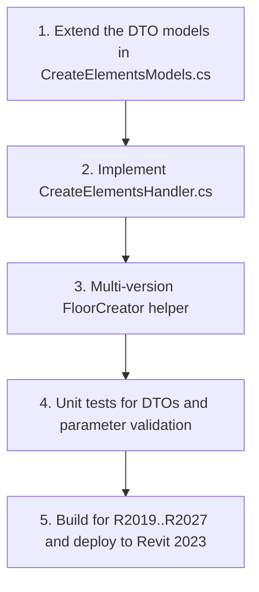

# Specification: Extending the structural design primitives library in `create_elements` (Revit 2019–2027)

## 1. Concept and architectural principle

In accordance with the principle of separation of responsibilities:
* **The Agent (Knowledge Base / Brain)** owns the design standards, calculations per SP 63.13330.2018 (anchorage, lap splicing, mesh layout, opening processing, 11.7 m cutting).
* **The RevitMCP Server (Actuator / Tools)** provides clean, reliable, fast, and typed modeling primitives in millimeters with no hardcoded business logic.

The server is extended with 5 key structural design primitives:
1. `slab` — floor slab / foundation slab (Floor / Foundation Slab).
2. `beam` — load-bearing beam / girder (Structural Framing).
3. `column` — load-bearing column / pier (Structural Column).
4. `area_reinforcement` — area reinforcement (AreaReinforcement).
5. `rebar` — bar reinforcement / bar arrays (Rebar).

---

## 2. Multi-version guarantee (Revit 2019 — 2027)

| Revit API aspect | Revit 2019–2021 | Revit 2022–2023 | Revit 2024–2027 | Compatibility strategy in RevitMCP |
|---|---|---|---|---|
| **Target framework** | `.NET Framework 4.8` | `.NET Framework 4.8` | `.NET 8.0-windows` | Multi-targeting `Directory.Build.props` (`net48` and `net8.0-windows`) |
| **`ElementId`** | `IntegerValue` (`int32`) | `IntegerValue` (`int32`) | `Value` (`int64`) | `ElementIdExtensions.ToLongId()` and `FromLongId()` with preprocessor directives |
| **Creating floors** | `doc.Create.NewFloor` / `Floor.Create` | `Floor.Create(doc, CurveLoop[], ...)` | `Floor.Create(doc, CurveLoop[], ...)` | Polymorphic `FloorCreator` (calling `Floor.Create` with a fallback via Reflection/`NewFloor` for older versions) |
| **Load-bearing beams (`Beam`)** | `NewFamilyInstance(Curve, ...)` | `NewFamilyInstance(Curve, ...)` | `NewFamilyInstance(Curve, ...)` | Single stable API method on all 2019–2027 versions |
| **Columns (`Column`)** | `NewFamilyInstance(XYZ, ...)` | `NewFamilyInstance(XYZ, ...)` | `NewFamilyInstance(XYZ, ...)` | Single method with base/top parameterization via `BuiltInParameter` |
| **`AreaReinforcement`** | `AreaReinforcement.Create(...)` | `AreaReinforcement.Create(...)` | `AreaReinforcement.Create(...)` | Stable API method + spacing and diameter parameterization |
| **Bar reinforcement** | `Rebar.CreateFromCurves(...)` | `Rebar.CreateFromCurves(...)` | `Rebar.CreateFromCurves(...)` | Stable API + `RebarShapeDrivenAccessor` for arrays |

---

## 3. Data models (DTO specifications in `CreateElementsModels.cs`)

### 3.1. Floor slab (`CreateSlabSpec`)
```json
{
  "action": "slab",
  "slab": {
    "boundaryPoints": [
      { "x": 0, "y": 0, "z": 0 },
      { "x": 12000, "y": 0, "z": 0 },
      { "x": 12000, "y": 9000, "z": 0 },
      { "x": 0, "y": 9000, "z": 0 }
    ],
    "holes": [
      [
        { "x": 4000, "y": 3000, "z": 0 },
        { "x": 6000, "y": 3000, "z": 0 },
        { "x": 6000, "y": 5000, "z": 0 },
        { "x": 4000, "y": 5000, "z": 0 }
      ]
    ],
    "levelId": 31071,
    "floorTypeId": 4120,
    "heightOffset": 0,
    "isStructural": true
  }
}
```

### 3.2. Load-bearing beam (`CreateBeamSpec`)
```json
{
  "action": "beam",
  "beam": {
    "startPoint": { "x": 0, "y": 0, "z": 3000 },
    "endPoint": { "x": 6000, "y": 0, "z": 3000 },
    "levelId": 31071,
    "familySymbolId": 5201,
    "familyName": "Concrete beam",
    "typeName": "400x600"
  }
}
```

### 3.3. Load-bearing column / pier (`CreateColumnSpec`)
```json
{
  "action": "column",
  "column": {
    "location": { "x": 6000, "y": 3000, "z": 0 },
    "baseLevelId": 31071,
    "topLevelId": 34495,
    "baseOffset": 0,
    "topOffset": -200,
    "rotationDegrees": 90.0,
    "familySymbolId": 6100,
    "familyName": "Concrete column",
    "typeName": "400x400"
  }
}
```

### 3.4. Area reinforcement (`CreateAreaReinforcementSpec`)
```json
{
  "action": "area_reinforcement",
  "areaReinforcement": {
    "hostElementId": 45120,
    "majorDirection": { "x": 1, "y": 0, "z": 0 },
    "boundaryCurves": null,
    "topMajorBarTypeId": 1205,
    "topMinorBarTypeId": 1205,
    "bottomMajorBarTypeId": 1206,
    "bottomMinorBarTypeId": 1206,
    "topMajorSpacing": 200,
    "topMinorSpacing": 200,
    "bottomMajorSpacing": 200,
    "bottomMinorSpacing": 200
  }
}
```

### 3.5. Bar reinforcement (`CreateRebarSpec`)
```json
{
  "action": "rebar",
  "rebar": {
    "hostElementId": 45120,
    "barTypeId": 1205,
    "curveSegments": [
      [
        { "x": 0, "y": 0, "z": 100 },
        { "x": 2500, "y": 0, "z": 100 }
      ]
    ],
    "normal": { "x": 0, "y": 0, "z": 1 },
    "layoutRule": "MaximumSpacing",
    "spacing": 200,
    "quantity": 10,
    "arrayLength": 2000
  }
}
```

---

## 4. Implementation plan



1. **Step 1:** Extending `CreateElementsModels.cs` with new structures (`CreateSlabSpec`, `CreateBeamSpec`, `CreateColumnSpec`, `CreateAreaReinforcementSpec`, `CreateRebarSpec`).
2. **Step 2:** Implementing handlers in `CreateElementsHandler.cs` with transactions, calling `SmartFailuresPreprocessor`, automatic activation of `FamilySymbol.Activate()`, and converting all mm to feet.
3. **Step 3:** Implementing the universal `FloorCreator` for seamless operation from Revit 2019 to 2027.
4. **Step 4:** Adding unit tests to `RevitMCP.Tests`.
5. **Step 5:** Checking cross-compilation (R2023 `net48` and R2025 `net8.0-windows`), running tests, deploying to Revit 2023.
