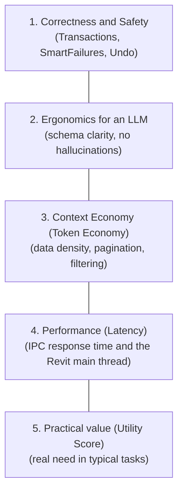
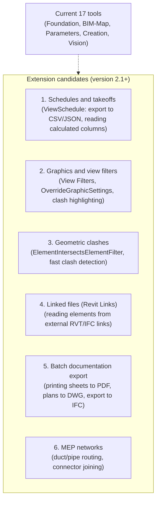

# Revit MCP Server Testing Program and Methodology (Testing & Evaluation Specification)

> **Document status:** Active
> **Version:** 1.0
> **Test purpose:** Comprehensive verification of all 17 tools and 3 resources of the MCP server on a real project in Revit 2023, assessment of the practical usefulness of each tool for an autonomous AI agent, measurement of speed and context consumption (Token Economy), and identification of missing capabilities (Gap Analysis).

---

## 1. Evaluation Methodology and Criteria (Evaluation Framework)

Unlike traditional unit tests (which only check that the code does not throw exceptions), the Revit MCP testing methodology evaluates the quality of interaction in the **"Autonomous LLM ⇄ Revit MCP Server ⇄ Revit API"** chain.

Each tool and scenario is evaluated by 5 key metrics:

1. **Correctness and Safety (Safety & Robustness):**
   * Transaction cleanliness: transactions have clear names in the Revit undo history (Undo/Redo).
   * Modal window suppression: warnings such as "Duplicate Mark values" or family information dialogs are intercepted and do not hang the Revit process.
   * Unit conversion: no scaling errors (all input and output data in mm / degrees, internal in feet / radians).

2. **LLM Ergonomics (Agent Ergonomics):**
   * How easily the LLM can form a valid JSON without additional hints.
   * Clarity of error messages (Error Messaging): if a tool fails, does it return enough context for the agent to self-correct without human help.

3. **Context Economy (Token Economy):**
   * Volume of returned JSON: whether the response overloads the model's context window.
   * Presence of pagination and field projection (`fields: ['id', 'parameters']`).

4. **Performance (Latency & Scalability):**
   * Response time on light operations (up to 50 ms).
   * Response time on heavy operations on a real model of 15 000+ elements (up to 2–3 sec).

5. **Practical Value (Utility Score from 1 to 5):**
   * **5 — Must-Have (Critically important):** Without it, the agent is helpless or spends thousands of tokens.
   * **4 — High Value (High value):** Significantly speeds up work and simplifies scenarios.
   * **3 — Moderate (Medium value):** Useful in specific tasks, but may be duplicated by `execute_csharp`.
   * **2 — Low Value (Low value / Candidate for simplification):** Rarely used or generates excessive complexity.
   * **1 — Redundant:** Can be fully removed without loss of capabilities.

---

## 2. Tool Testing Matrix (17 Tools + 3 Resources)

### Group I. System and session tools

#### 1. `ping`
* **Purpose:** Express liveness check of the connection via Named Pipe.
* **Test case:** Call with Revit open and with Revit closed.
* **Expected result:** `{"success": true, "revitVersion": "2023", "activeDocument": "..."}` in < 10 ms. With Revit closed — an immediate informative `PIPE_UNAVAILABLE` error.
* **Evaluation question:** Is the tool sufficient, or should it be merged with `list_revit_instances`?

#### 2. `list_revit_instances`
* **Purpose:** Discovery of all running Revit sessions with their PID, active files, and UI status (`Ready`, `InSketchMode`, `ModalActive`).
* **Test case:** Launch one Revit 2023 instance. Check the status in normal mode and with the parameters dialog open.
* **Expected result:** Correct JSON with session metadata and the UI flag.
* **Evaluation question:** How often does the agent need to monitor the `InSketchMode` status?

#### 3. `select_revit_instance`
* **Purpose:** Routing commands to the selected PID when working with multiple Revit windows.
* **Test case:** Call with an existing PID and a non-existent PID.

---

### Group II. Free code and safety

#### 4. `execute_csharp`
* **Purpose:** Execution of arbitrary C# code (Roslyn) with direct access to `context.Doc`, `context.App`, transactions, and `context.Print()` output.
* **Test cases:**
  1. *Read without transaction:* Counting the total number of elements in the document via `FilteredElementCollector`.
  2. *Write with transaction:* Creating a model line with automatic addition to `context.AddAffectedElements()`.
  3. *Error interception check:* Attempting to execute incorrect C# syntax — checking the readability of the Roslyn error message.
  4. *Smart Failures Test:* Modifying the "Mark" parameter to an already existing value — confirming that the modal window does not block Revit, the warning is removed, and a `warnings` array is returned in the JSON.
  5. *UI Tracking:* Displaying the agent name ("Antigravity") and action description in the `AgentActivityDockablePane` pane.
* **Evaluation question:** Is `execute_csharp` an absolute universal tool covering any non-standard task?

---

### Group III. Introspection and fast retrieval

#### 5. `inspect_schema`
* **Purpose:** Getting the list of available categories, families, type sizes, and parameter definitions without modifying the model.
* **Test cases:**
  1. Call without parameters — getting the list of all project categories with element counts.
  2. Query by a localised category name (e.g. `"Walls"`) and by BuiltInCategory `"OST_Walls"`.
  3. Query with the flag `includeParameters: true` — checking retrieval of the list of available type parameters.
* **Evaluation question:** Is the response volume too large with `includeParameters: true`? Is filtering by parameter group (Identification, Geometry) needed?

#### 6. `query_elements`
* **Purpose:** Fast retrieval of elements with pagination (`offset`, `limit`), filters by category, level, BoundingBox (in mm), and conditions on parameters.
* **Test cases:**
  1. Retrieving the first 10 walls with fields `id`, `category`, `parameters`.
  2. Spatial BoundingBox filter: retrieving elements in the specified volume $[(X_1, Y_1, Z_1), (X_2, Y_2, Z_2)]$ in mm.
  3. Parameter filter: `name: "Length", operator: "GreaterThan", value: "3000"`.
* **Evaluation question:** Is parameter filtering convenient? Are the operators `Equals`, `Contains`, `StartsWith`, `GreaterThan`, `LessThan` enough?

---

### Group IV. Agent knowledge base (Knowledge Base)

#### 7. `record_lesson` & 8. `query_knowledge` & Resource `revit://knowledge/rules`
* **Purpose:** Long-term agent memory between sessions for storing technical nuances of the Revit API.
* **Test cases:**
  1. Saving a rule: topic "Duplicate Mark Warnings", category "Transactions", content about the behavior of `SmartFailuresPreprocessor`.
  2. Checking that a Markdown file appears in `%LocalAppData%/RevitMCP/knowledge/`.
  3. Searching for "duplicate mark" via `query_knowledge`.
  4. Reading the `revit://knowledge/rules` resource.
* **Evaluation question:** Does the LLM use the knowledge base proactively, or is a system prompt requiring knowledge checks before complex scripts needed?

---

### Group V. Parameter and document management

#### 9. `manage_parameters`
* **Purpose:** Batch reading (`get`) and writing (`set`) of element parameters by name, GUID, or `BuiltInParameter` with bidirectional SI unit conversion.
* **Test cases:**
  1. Reading parameters of the selected wall (Type Name, Length, Volume, Mark, Comments).
  2. Batch writing of string parameters ("Comments", "Mark") on several elements.
  3. Batch writing of numeric parameters with a specified unit (`unit: "mm"`, `value: 3500`).
* **Evaluation question:** How much more convenient is this tool than `execute_csharp` for mass parameterization?

#### 10. `manage_documents`
* **Purpose:** Document lifecycle management (`list`, `open`, `save`, `save_as`, `close`, `sync_with_central`).
* **Test cases:**
  1. `list`: checking the list of documents, paths, `isModified`, `isWorkshared` flags.
  2. `save`: saving the active document.
  3. Checking `sync_with_central` parameters (passing the sync comment and releasing borrowed element locks).
* **Evaluation question:** Is the functionality sufficient for automatic nightly workflows (Sync & Close)?

---

### Group VI. BIM-Map, SQLite WAL and local cache

#### 11. `get_bim_map`
* **Purpose:** Instant return of model topology (L0: levels, axis grid with coordinates in mm, categories with element counts) or spatial structure (L1: rooms with dimensions).
* **Test cases:**
  1. Initial call — automatic creation of the SQLite DB in `%LocalAppData%/RevitMCP/models/{Guid}.db` and indexing.
  2. Repeated call — returning topology from the local cache in < 50 ms without touching the Revit Main Thread.
  3. Measuring token consumption of the L0 map compared to full element export.
* **Evaluation question:** Is the L0 format ideal for the agent's initial acquaintance with a new project?

#### 12. `search_bim_map`
* **Purpose:** Full-text FTS5 search across millions of elements (mark, family name, type, comments, category).
* **Test cases:**
  1. Searching for elements by rebar / window mark.
  2. Search by localised terms (e.g. "Column", "Floor") on a non-English UI.
  3. Measuring FTS5 query execution speed on a 15 000+ element database (target time < 5 ms).
* **Evaluation question:** Does this tool replace 90% of typical `FilteredElementCollector` calls?

#### 13. `rebuild_bim_map` & 14. `manage_cache`
* **Purpose:** Forced background reindexing and disk space control (2 GB limit, 30-day retention).
* **Test cases:**
  1. Calling `rebuild_bim_map` with `scope: "topology"` and `scope: "full"`.
  2. Checking disk status `manage_cache(action: "status")` — checking the size of `.db`, `.db-wal`, `.db-shm`.
  3. Calling `manage_cache(action: "cleanup")`.

---

### Group VII. Multimodality, geometry and element creation

#### 15. `export_view_image`
* **Purpose:** Exporting a view to Base64 PNG/JPEG for passing to a Vision LLM.
* **Test cases:**
  1. Exporting the current active view (floor plan or 3D view) at 1024 px resolution.
  2. Checking the returned object `{ type: "image", data: "...", mimeType: "image/png" }`.
  3. Checking render quality and the ability of a multimodal neural network to recognize architectural elements.
* **Evaluation question:** Is 1024–2048 px resolution enough for detailed visual analysis?

#### 16. `transform_elements`
* **Purpose:** Spatial transformations (`move`, `rotate`, `copy`, `delete`) in millimeters and degrees.
* **Test cases:**
  1. Moving an element: `dx: 1000, dy: 0, dz: 0` (shift of 1 meter to the right).
  2. Rotating an element: `angleDegrees: 90` around the vertical axis.
  3. Copying an element with an offset.
  4. Deleting an element.
* **Evaluation question:** Is a single tool with an `action` parameter more convenient than 4 separate tools?

#### 17. `create_elements`
* **Purpose:** Creating basic model elements (grids, levels, walls, families, rooms, lines) in millimeters.
* **Test cases:**
  1. Creating a grid axis: `startPoint: [0, 0, 0]`, `endPoint: [0, 10000, 0]`, `name: "Test-1"`.
  2. Creating a wall: by points with a height of 3000 mm.
  3. Inserting a point family by coordinates with auto-activation of the type size.
* **Evaluation question:** Is this tool sufficient for basic generative modeling?

---

## 3. End-to-End Practical Scenarios (End-to-End Scenarios)

To evaluate tool synergy, 3 end-to-end scenarios are executed:

### Scenario 1: Intelligent model audit (Without changing geometry)
1. The agent calls `get_bim_map` (L0) and instantly gets the project composition (levels, axis grid, list of categories).
2. Calls `search_bim_map` to find elements with empty marks or dubious names.
3. Calls `query_elements` for detailed retrieval of suspicious element parameters.
4. Exports the floor plan with violations via `export_view_image`.
5. Produces a final structured report for the user with an attached image.
* **Success metric:** The full audit is completed in less than 3 seconds and consumes less than 4 000 context tokens.

### Scenario 2: Batch apartment mapping / marking with collisions
1. The agent requests via `query_elements` the list of walls or doors on the selected floor.
2. Batch-assigns marks to them via `manage_parameters`, deliberately creating a duplicate.
3. The `SmartFailuresPreprocessor` behavior is verified: Revit does not show a popup, does not block the screen, the transaction commits successfully, and in the `warnings` field the agent receives the list of duplicates.
4. The agent sees the warning in the response and makes a second call to fix the numbering.
* **Success metric:** 0 UI hangs, 100% transparency for the neural network.

### Scenario 3: Generative modeling of grid and walls
1. The agent creates 2 grid axes via `create_elements(action: "grid")`.
2. Creates a +3300 mm elevation level via `create_elements(action: "level")`.
3. Creates a closed contour of 4 walls via `create_elements(action: "wall")`.
4. Exports the 3D view via `export_view_image` for visual verification of joint correctness.
* **Success metric:** All elements are built with precise millimeter-level alignment.

---

## 4. Gap analysis: what the server may be missing (Missing Capabilities)

During testing we will assess the need to add the following specialized modules:

1. **Schedules and quantity takeoffs (`read_schedule` / `export_schedule`):**
   * *Problem:* In Revit, many important data are formed inside schedules (calculated formulas, volumes by layers, groupings).
   * *Question:* Is extracting raw element parameters enough, or is direct access to `ViewSchedule` tabular data needed?
2. **View graphics and filter management (`color_elements` / `override_graphics`):**
   * *Problem:* It is hard for a human and a Vision model to navigate a black-and-white drawing.
   * *Potential:* A tool for color highlighting of elements (for example: color load-bearing walls blue, partitions gray, and elements with errors bright red).
3. **Geometric intersection search (`find_intersections` / `clash_detect`):**
   * *Problem:* Finding intersections via raw C# script requires knowledge of the nuances of `SolidCurveIntersection` and `ElementIntersectsFilter`.
   * *Potential:* A ready-made high-performance clash search between two sets of elements.
4. **Linked models (`query_linked_elements`):**
   * *Problem:* In real projects, structures (RC), architecture (AR), and MEP networks (HVAC/plumbing) reside in different linked RVT files.
   * *Potential:* The ability to transparently read elements from linked `RevitLinkInstance` links.
5. **Drawing and model export (`export_cad_pdf`):**
   * *Problem:* An engineer often needs to issue a PDF set or export IFC for review.

---

## 5. Final scorecard table (Scorecard Template)

Based on the results of passing the testing program, a final scorecard will be filled in:

| Tool / Function | Test status | Time (ms) | Tokens (in/out) | Utility score (1–5) | Notes and improvement suggestions |
| :--- | :---: | :---: | :---: | :---: | :--- |
| `ping` | ⏳ Pending | | | | |
| `list_revit_instances` | ⏳ Pending | | | | |
| `select_revit_instance` | ⏳ Pending | | | | |
| `execute_csharp` | ⏳ Pending | | | | |
| `inspect_schema` | ⏳ Pending | | | | |
| `query_elements` | ⏳ Pending | | | | |
| `record_lesson` | ⏳ Pending | | | | |
| `query_knowledge` | ⏳ Pending | | | | |
| `manage_parameters` | ⏳ Pending | | | | |
| `manage_documents` | ⏳ Pending | | | | |
| `get_bim_map` | ⏳ Pending | | | | |
| `search_bim_map` | ⏳ Pending | | | | |
| `rebuild_bim_map` | ⏳ Pending | | | | |
| `manage_cache` | ⏳ Pending | | | | |
| `export_view_image` | ⏳ Pending | | | | |
| `transform_elements` | ⏳ Pending | | | | |
| `create_elements` | ⏳ Pending | | | | |
| *Resource: sessions* | ⏳ Pending | | | | |
| *Resource: knowledge/rules* | ⏳ Pending | | | | |
| *Resource: bim_map* | ⏳ Pending | | | | |
| *Smart Failures Suppression* | ⏳ Pending | | | | |
| *DockablePane UI Log* | ⏳ Pending | | | | |

---

## 6. Testing procedure with the user

1. The user launches Revit 2023 and opens a working project.
2. A connection check (`ping`) and a check of the dockable pane registration in Revit (`AgentActivityDockablePane`) are performed.
3. The initial `get_bim_map` cache build is started — the real model indexing time is recorded.
4. A series of test queries is run for each functional group.
5. Utility scores are filled in and the list of version 2.1 improvements is formed.
