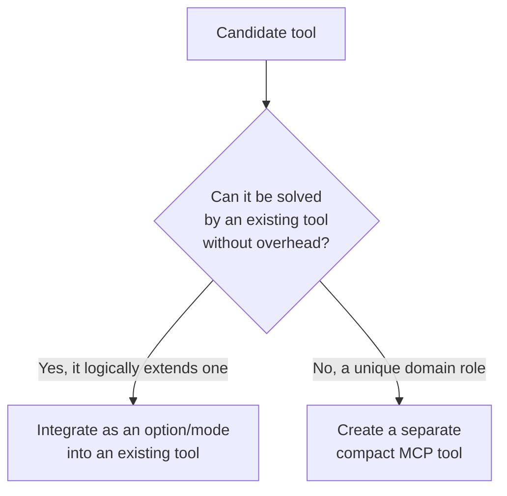
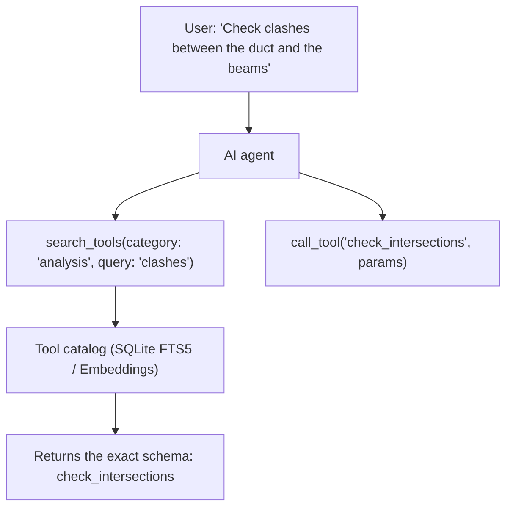

# Revit MCP Tool Specification and Architectural Audit

> **Document purpose:** Audit all 17 existing server tools and 5 potential new tools. Eliminate function duplication (Tool Bloat), clearly fix the responsibility zone of each tool, and determine the optimal composition of the Actuator interface for the AI agent.

---

## 1. Architectural principle: Fighting "Tool Bloat" (tool proliferation)

Each tool declared in the MCP server:
1. **Takes space in the Context Window:** The JSON schema of each tool is passed to the language model in the system prompt (on average 300–800 tokens per tool). 30 tools means 15 000–25 000 tokens of overhead per request.
2. **Creates cognitive load on the LLM (Tool Selection Paralysis):** The more similar tools there are, the higher the probability that the agent calls the wrong tool or gets confused in parameters.

**The golden rule of Revit MCP:**
> *A new tool is added ONLY if its task CANNOT be solved by an existing tool without writing cumbersome C# code or overloading the context with extra data.*

---

## 2. Audit of the 17 existing tools

All 17 tools are divided into 6 strict functional clusters with no mutual overlap:

| Cluster | Tool | What task it solves | Why it is irreplaceable (Cannot be removed/merged) |
| :--- | :--- | :--- | :--- |
| **System and Sessions** | `ping` | Liveness check of the IPC channel to Revit | Fast healthcheck (40 ms) without opening documents. |
| | `list_revit_instances` | Discovery of open Revit versions and processes | Lets the agent navigate a multi-instance environment (2023, 2024, 2025). |
| | `select_revit_instance` | Switching the target Revit process (PID) | Manages the router context (`RevitSessionRouter`). |
| **Universal executor** | `execute_csharp` | Execution of arbitrary C# code via Roslyn | "Heavy artillery". Solves any non-standard Revit API task with transactions, UI tracker and SmartFailures. |
| **Audit and Data Reading** | `inspect_schema` | Reading **project metadata** (categories, family type sizes, available parameters) | Does not read instances in the model. Serves for validating type names before creating elements. |
| | `query_elements` | Searching for **element instances** by filters (category, level, AABB box in mm, parameters) | The primary element search tool with pagination (up to 200 pcs) to prevent context explosion. |
| | `manage_parameters` | Batch reading and writing of parameter values | Automatic conversion of system units (feet $\leftrightarrow$ mm, m², m³). Supports search by name, GUID or BIP. |
| **Documents and Project** | `manage_documents` | File management (.rvt/.rfa): open, save, close, sync with the central model | Manages the project lifecycle and collaboration (Worksharing). |
| **Fast cache (BIM-Map)** | `get_bim_map` | Getting the model structure (levels, grids, links, rooms) | Retrieved from SQLite WAL in 1–2 ms without calling the Revit API (saves 95% of time). |
| | `search_bim_map` | Instant full-text search (FTS5) by names, marks, comments | Fast search for element IDs by keywords in 0.5 ms. |
| | `rebuild_bim_map` | Background reindexing of the model database | Called after mass geometry edits. |
| | `manage_cache` | Control of the SQLite cache disk space | Enforces the quota (2 GB LRU, 30 days) to prevent disk clutter. |
| **Geometry and Modification** | `create_elements` | Creating basic BIM elements (walls, slabs with openings, beams, columns, rebar, levels, grids) | Accepts clean millimeters, hides the complexity of API multi-versioning (2019–2027). |
| | `transform_elements` | Geometric transformations (move, rotate, copy, delete) | Basic manipulations of existing elements in isolated transactions. |
| **Vision and Control** | `export_view_image` | Exporting the current 3D/2D view to Base64 PNG/JPEG | The agent's eyes for multimodal verification of work results. |
| **Long-term memory** | `record_lesson` | Saving engineering rules and API nuances to the knowledge base | Prevents the agent from repeating the same mistakes. |
| | `query_knowledge` | Search in the knowledge base and RC regulations | Reading saved instructions and SP rules. |

---

## 3. Analysis of the 5 candidate tools: Are they needed as separate tools?

Let's check each candidate for duplication with existing tools:



---

### Candidate 1: `check_intersections` (Geometric intersections and clashes) — [IMPLEMENTED AND DEPLOYED]
* **Status:** Implemented in the plugin and CLI code, 43/43 tests passed, deployed in Revit 2023.
* **What it does:** Checks the physical intersection of 3D solids (`ElementIntersectsElementFilter` / `ElementIntersectsSolidFilter`), returns the list of colliding elements, the clash dimensions in mm, and the intersection volume in m³ (`BooleanOperationsUtils.ExecuteBooleanOperation`).
* **Parameters:** `targetElementId` (required), `candidateCategories` (in Russian or `OST_*`), `candidateElementIds`, `activeViewOnly`, `calculateClashVolume`, `limit`.
* **Comparison with `query_elements`:**
  * `query_elements` has a `spatialBoundingBox` filter. But it is an **AABB (axis-aligned bounding box)**. If a beam runs diagonally or a wall is rotated by $45^\circ$, their AABB is huge and gives 80% false positives.
  * `query_elements` cannot calculate the clash volume or the fact of physical contact of solids.
* **Verdict:** **IMPLEMENTED as a separate tool `check_intersections`.** This is a fundamental spatial analysis function for BIM/RC (search for penetrations, slab supports, network clashes).

---

### Candidate 2: `manage_selection` (Reading and setting the user's selection) — [IMPLEMENTED AND DEPLOYED]
* **Status:** Implemented in the plugin and CLI code, covered by tests, deployed.
* **What it does:** 
  * `get`: returns the IDs of elements currently selected by the user on screen (`UIDocument.Selection.GetElementIds()`), with category, type size, and name.
  * `set`: selects the passed list of IDs on the user's screen (`UIDocument.Selection.SetElementIds()`).
* **Verdict:** **IMPLEMENTED as a separate tool `manage_selection`.** Minimalist (2 actions: get/set), 0 tokens of overload, colossal gain in convenience (Human-in-the-Loop).

---

### Candidate 3: `inspect_element_geometry` (Analytical geometry of an element) — [IMPLEMENTED AND DEPLOYED]
* **Status:** Implemented in the plugin and CLI code, covered by tests, deployed.
* **What it does:** Accepts `elementId`, extracts exact geometry in millimeters (mm):
  * For slabs (`slab`): thickness $H$, coordinates of the outer contour points and inner openings.
  * For walls (`wall`): the location curve (Start, End), length, thickness, orientation vector.
  * For beams/columns (`beam`/`column`): the reference curve or insertion point and orientation.
  * For arbitrary solids: volume in m³, weighted center of mass (Centroid), face polygons.
* **Verdict:** **IMPLEMENTED as a separate tool `inspect_element_geometry`.** Lets the agent instantly get the exact contour of a slab or wall for rebar layout without C# scripts.

---

### Candidate 4: `visual_override` (Visibility and graphics management in the view) — [IMPLEMENTED AND DEPLOYED]
* **Status:** Implemented in the plugin and CLI code, covered by tests, deployed.
* **What it does:** Overrides the graphics of elements in the active or target view:
  * Transparency `transparency` (0–100%) and halftone `halftone`.
  * Line color and solid surface fill color `color` `{ r, g, b }`.
  * Isolation and hiding of elements (`isolate`, `hide`, `unhide`, `reset_isolate`).
  * Enabling solid 3D display of rebar (`solidIn3D` / `unobscuredInView`).
* **Verdict:** **IMPLEMENTED as a separate tool `visual_override`.** Gives the agent visual control when delivering work and highlighting clashes.

---

### Candidate 5: `export_schedule` (Reading project schedules) — [IMPLEMENTED AND DEPLOYED]
* **Status:** Implemented in the plugin and CLI code, covered by tests, deployed.
* **What it does:** 
  * `list`: the list of all schedules available in the model (`ViewSchedule`).
  * `get_data`: line-by-line extraction of the schedule table headers and cells (steel consumption schedules, element schedules, room legends) into clean structured JSON.
* **Verdict:** **IMPLEMENTED as a separate tool `export_schedule`.** Lets you instantly check steel consumption schedules, room legends, and rebar schedules without iterating over model elements.

---

## 4. Final server composition: 22 native tools (100% ready)

```
┌─────────────────────────────────────────────────────────────────────────┐
│                FULL TOOL ROSTER OF REVIT MCP (22 TOOLS)                 │
├─────────────────────────────┬───────────────────────────────────────────┤
│ 1. ping                     │ IPC channel healthcheck                   │
│ 2. list_revit_instances     │ Discover running Revit versions and PIDs  │
│ 3. select_revit_instance    │ Switch the target Revit process           │
│ 4. execute_csharp           │ Universal Roslyn C# executor              │
│ 5. record_lesson            │ Record engineering lessons and rules      │
│ 6. query_knowledge          │ Read the agent knowledge base             │
│ 7. manage_documents         │ Manage RVT/RFA files and worksharing      │
│ 8. inspect_schema           │ Validate project types and metadata       │
│ 9. manage_parameters        │ Batch read/write of parameters            │
│ 10. export_schedule         │ Read schedules and takeoff tables         │
│ 11. query_elements          │ Find element instances with filters       │
│ 12. get_bim_map             │ BIM-Map hierarchy from SQLite in 1 ms     │
│ 13. search_bim_map          │ Full-text FTS5 search over the cache      │
│ 14. rebuild_bim_map         │ Re-index the SQLite database              │
│ 15. manage_cache            │ Control disk quotas (%LocalAppData%)      │
│ 16. transform_elements      │ Move, rotate, copy, delete                │
│ 17. create_elements         │ Parametric creation of BIM/structural elements │
│ 18. export_view_image       │ Multimodal 2D/3D export to Base64 PNG     │
│ 19. check_intersections     │ 3D solid intersection and clash check     │
│ 20. manage_selection        │ Interact with the user selection          │
│ 21. inspect_element_geometry │ Analytical outlines and sizes in mm       │
│ 22. visual_override         │ Transparency, colour and Solid mode in 3D │
└─────────────────────────────┴───────────────────────────────────────────┘
```

---

## 5. Scaling architecture: Tool RAG and cascading discovery (Hierarchical Discovery)

### The problem of tool count growth:
With 17–22 tools, the total JSON schema size is about **3 000 – 4 000 tokens**. This is a comfortable volume for modern LLMs.
However, if we start exposing all 80+ specialized Revit ribbon tools (trusses, curtain walls, ducts, lintels, specifiers) at the MCP level:
* Schemas will take **25 000 – 40 000 tokens** per EVERY request.
* **"Tool Selection Paralysis"** will arise: the model will start confusing schemas that are close in meaning.

### Solution: Cascading catalog (Tool RAG / Progressive Disclosure)



#### Architectural model of the cascading catalog:
1. **Core of basic tools (Eager Core):**
   * Only universal, constantly used tools are declared in the standard `tools/list`: `execute_csharp`, `manage_selection`, `search_tools`, `call_tool`.
2. **Dynamic catalog (Tool Registry):**
   * All other specialized tools are registered in the internal catalog (in our SQLite database `tools_registry`) with category meta-tags:
     * `Category = "analysis"` (`check_intersections`, `inspect_element_geometry`, `export_schedule`).
     * `Category = "modeling"` (`create_elements`, `transform_elements`).
     * `Category = "view"` (`export_view_image`, `visual_override`).
     * `Category = "data"` (`manage_parameters`, `manage_documents`).
3. **Meta-tool `search_tools`:**
   * Accepts a category or a text query (`query: "slab reinforcement"`).
   * Instantly returns the schema of only the needed tool.
4. **Universal facade `call_tool`:**
   * Executes the found tool with validation of the passed arguments.

> **Benefit:** Lets you scale Revit MCP even to **500+ highly specialized tools** while keeping context consumption within **1 000 tokens**!

---

## 6. Question for approval

Do you agree with this composition (5 tools) and the cascading Tool RAG strategy for the future?
If yes — we start implementing the first tool: **`check_intersections`**.
